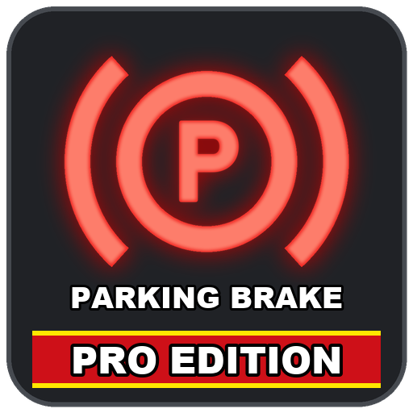

# ModHub upload: Parking Brake Pro Edition

What to enter in the GIANTS ModHub upload form for this mod. Each text box below has a copy button on GitHub.



**Mod Icon (512x512):** [`icon_512.png`](icon_512.png)

| Field | Value |
|-------|-------|
| Title English | Parking Brake Pro Edition |
| Title German | Feststellbremse Pro Edition |
| Title French | Frein de stationnement Pro Edition |
| Version | `1` `0` `9` `1` |
| Author | DTM Mods, PropaineX |
| Manufacturer | Lizard |
| Category 1 | Gameplay |
| Category 2 | Not Set |
| Category 3 | Not Set |

## Title English
```text
Parking Brake Pro Edition
```

## Title German
```text
Feststellbremse Pro Edition
```

## Title French
```text
Frein de stationnement Pro Edition
```

## Description English
```text
Parking Brake Pro Edition adds a real parking brake to every drivable vehicle. Press backslash (\) to put it on and press it again to release it.

- Works in every drivable vehicle; the key can be changed in the controls menu
- While it is on, the vehicle holds with full brakes, the throttle does nothing and cruise control is switched off
- A warning blinks if you try to drive with the brake on
- A BRAKE light next to the speedometer is lit while the parking brake is on, and also whenever the game, an AI helper or another mod holds the vehicle with the handbrake
- The parking brake is saved with the vehicle
- AI helpers are not held back by it
- Works in multiplayer

Changelog 1.0.9.0:
- New mod icon with "PARKING BRAKE" written on it.
```

## Description German
```text
Feststellbremse Pro Edition gibt jedem Fahrzeug eine echte Feststellbremse. Drück Backslash (\), um sie anzuziehen, und noch einmal, um sie zu lösen.

- Funktioniert in jedem fahrbaren Fahrzeug; die Taste lässt sich im Steuerungsmenü ändern
- Solange sie angezogen ist, hält das Fahrzeug mit voller Bremskraft, Gas geben bewirkt nichts und der Tempomat wird ausgeschaltet
- Eine Warnung blinkt, wenn du mit angezogener Bremse losfahren willst
- Eine BRAKE-Leuchte neben dem Tacho leuchtet, solange die Feststellbremse angezogen ist, und auch immer dann, wenn das Spiel, ein Helfer oder eine andere Mod das Fahrzeug mit der Handbremse hält
- Die Feststellbremse wird mit dem Fahrzeug gespeichert
- Helfer werden von ihr nicht aufgehalten
- Funktioniert im Mehrspielermodus

Changelog 1.0.9.0:
- Neues Mod-Symbol mit der Aufschrift "PARKING BRAKE".
```

## Description French
```text
Frein de stationnement Pro Edition ajoute un vrai frein de stationnement à chaque véhicule. Appuyez sur la barre oblique inversée (\) pour le serrer, et à nouveau pour le desserrer.

- Fonctionne dans chaque véhicule conduisible ; la touche peut être modifiée dans le menu des commandes
- Tant qu'il est serré, le véhicule est retenu avec tous ses freins, l'accélérateur n'a aucun effet et le régulateur de vitesse est coupé
- Un avertissement clignote si vous essayez de rouler frein serré
- Un voyant BRAKE à côté du compteur s'allume tant que le frein de stationnement est serré, et aussi chaque fois que le jeu, un ouvrier ou un autre mod retient le véhicule avec le frein à main
- Le frein de stationnement est sauvegardé avec le véhicule
- Les ouvriers ne sont pas bloqués par lui
- Fonctionne en multijoueur

Changelog 1.0.9.0 :
- Nouvelle icône du mod avec l'inscription "PARKING BRAKE".
```

## Before uploading

- Translations in the mod itself: English only. The title, description, key name, help texts and the warning have no German or French.
