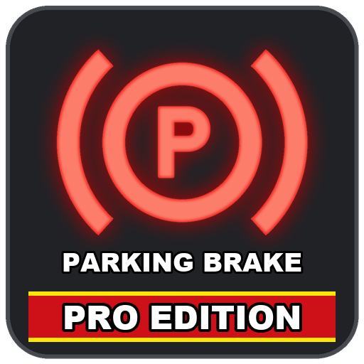

# ModHub upload: Parking Brake Pro Edition

What to enter in the GIANTS ModHub upload form for this mod. Each text box below has a copy button on GitHub.



**Mod Icon (512x512):** [`icon_512.png`](icon_512.png)

| Field | Value |
|-------|-------|
| Title English | Parking Brake Pro Edition |
| Title German | Feststellbremse Pro Edition |
| Title French | Frein de stationnement Pro Edition |
| Version | `1` `0` `9` `1` |
| Author | DTM Mods, PropaineX |
| Manufacturer | Lizard |
| Category 1 | Gameplay |
| Category 2 | Not Set |
| Category 3 | Not Set |

## Title English
```text
Parking Brake Pro Edition
```

## Title German
```text
Feststellbremse Pro Edition
```

## Title French
```text
Frein de stationnement Pro Edition
```

## Description English
```text
Description: Adds a parking brake to every drivable vehicle: while it is on, the vehicle holds with full brakes and does not drive off.
Hotkeys: Backslash (\) in a vehicle puts the parking brake on, and again releases it. Controller: none by default, set one under Settings > Controls.
GitHub: https://github.com/DTM-Mods/FS25_ParkingBrake_ProEdition

While the parking brake is on, the vehicle holds with full brakes, the throttle does nothing and cruise control is switched off. A warning blinks if you try to drive. The BRAKE light on the speedometer is lit while the parking brake is on, and also whenever the game, an AI helper or another mod holds the vehicle with the handbrake. The parking brake is saved with the vehicle and works in multiplayer. AI helpers are not held back by it.
```

## Description German
```text
Beschreibung: Fügt jedem fahrbaren Fahrzeug eine Feststellbremse hinzu: Ist sie angezogen, hält das Fahrzeug mit voller Bremskraft und fährt nicht los.
Tastenkombinationen: Backslash (\) im Fahrzeug zieht die Feststellbremse an, noch einmal gedrückt löst sie. Controller: standardmäßig keine Belegung, unter Einstellungen > Steuerung festlegen.
GitHub: https://github.com/DTM-Mods/FS25_ParkingBrake_ProEdition

Solange die Feststellbremse angezogen ist, hält das Fahrzeug mit voller Bremskraft, das Gaspedal bewirkt nichts und der Tempomat wird ausgeschaltet. Wenn du losfahren willst, blinkt eine Warnung. Die BRAKE-Leuchte am Tacho leuchtet, solange die Feststellbremse angezogen ist, und auch immer dann, wenn das Spiel, ein KI-Helfer oder eine andere Mod das Fahrzeug mit der Handbremse hält. Die Feststellbremse wird mit dem Fahrzeug gespeichert und funktioniert im Mehrspieler. KI-Helfer werden von ihr nicht aufgehalten.
```

## Description French
```text
Description : ajoute un frein de stationnement à chaque véhicule conduisible : tant qu'il est serré, le véhicule est retenu avec tous ses freins et ne démarre pas.
Raccourcis clavier : la barre oblique inversée (\) dans un véhicule serre le frein de stationnement, une nouvelle pression le desserre. Manette : aucune touche par défaut, à définir dans Paramètres > Commandes.
GitHub : https://github.com/DTM-Mods/FS25_ParkingBrake_ProEdition

Tant que le frein de stationnement est serré, le véhicule est retenu avec tous ses freins, l'accélérateur n'a aucun effet et le régulateur de vitesse est coupé. Un avertissement clignote si vous essayez de rouler. Le voyant BRAKE du compteur s'allume tant que le frein de stationnement est serré, et aussi chaque fois que le jeu, un ouvrier ou un autre mod retient le véhicule avec le frein à main. Le frein de stationnement est sauvegardé avec le véhicule et fonctionne en multijoueur. Les ouvriers ne sont pas bloqués par lui.
```

## Before uploading

- Translations in the mod itself: English only. The title, description, key name, help texts and the warning have no German or French.
